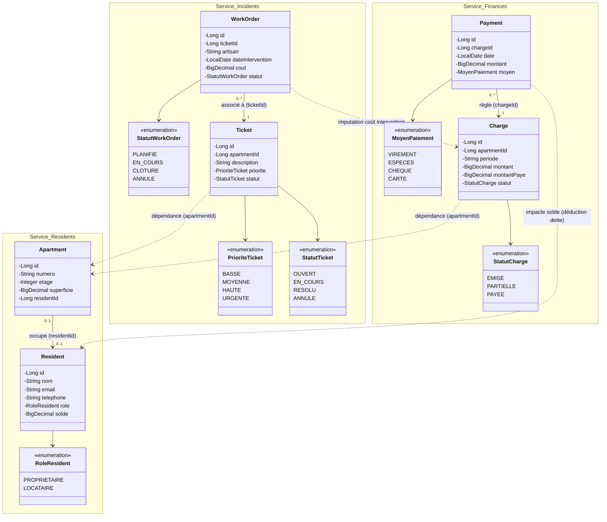
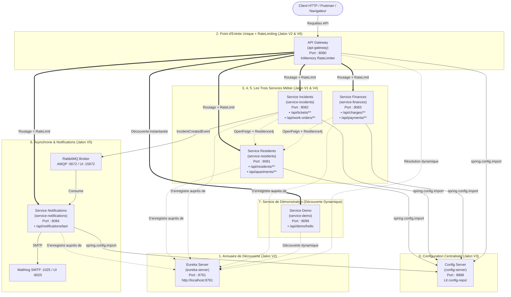
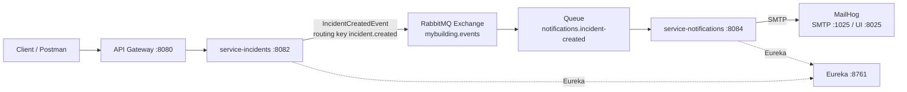

# MyBuilding — Plateforme de Gestion de Copropriété (PFM)

---

## 1. Description du Projet

**MyBuilding** est une application web modulaire et distribuée conçue pour la gestion administrative, technique et financière d’un immeuble en copropriété (syndic). 

Développée selon une **architecture microservices**, l’application répond aux besoins clés du syndic et des copropriétaires :
* **Gestion des résidents et du parc immobilier** : enregistrement des copropriétaires et locataires, gestion des appartements et tenue à jour du solde de chaque résident.
* **Gestion technique et maintenance** : signalement des pannes via des tickets d'incidents, planification des ordres d'intervention (WorkOrders) pour les artisans et suivi des coûts de réparation.
* **Gestion financière et comptable** : émission des appels de charges mensuels par appartement, enregistrement des règlements (partiels ou totaux), contrôle strict des impayés et imputation des dépenses de maintenance au budget.

### Prérequis Techniques (Environnement Local)

* **Java JDK 21+** (le projet cible Java 21 avec l'option de compilation `-parameters`)
* **Apache Maven 3.9+**
* **Docker & Docker Compose** (pour exécuter RabbitMQ 3.13 et MailHog au Jalon V5)
* **IntelliJ IDEA** (exécution via le client HTTP intégré `requests.http`) ou **Postman** (`MyBuilding.postman_collection.json`)

---

## 2. Diagramme de Classes UML Global

Ce diagramme présente les entités métier de chacun des services de la plateforme, leurs énumérations, leurs relations internes ainsi que les **dépendances inter-services matérialisées par des flèches en pointillés (`..>`)**, indépendantes des protocoles de communication sous-jacents (REST/Feign, Kafka, etc.).



---

## 3. Schéma de l'Architecture Globale et Ports

L’architecture globale repose sur les services d'infrastructure, les microservices métier, le broker asynchrone et la passerelle sécurisée par Rate Limiting :



### Récapitulatif des Applications :

| N° | Application | Nom Spring (`spring.application.name`) | Port | Rôle & Description |
| :-: | :--- | :--- | :---: | :--- |
| **0** | **Eureka Server** | `eureka-server` | **8761** | Annuaire centralisé d'enregistrement et de découverte *(Config locale)* |
| **1** | **Config Server** | `config-server` | **8888** | Serveur centralisé de configuration Spring Cloud Config *(Config locale)* |
| **2** | **API Gateway** | `api-gateway` | **8080** | Passerelle réactive avec routage dynamique et statique |
| **3** | **Service Residents** | `service-residents` | **8081** | Gestion des résidents, des appartements et des soldes |
| **4** | **Service Incidents** | `service-incidents` | **8082** | Gestion des tickets de pannes et des ordres de travail (artisans) |
| **5** | **Service Finances** | `service-finances` | **8083** | Gestion des appels de charges, des paiements et du budget |
| **6** | **Service Demo** | `service-demo` | **8099** | Preuve de découverte dynamique instantanée sans redémarrage de la Gateway |
| **7** | **Service Notifications** | `service-notifications` | **8084** | Consommation des événements RabbitMQ et envoi des emails |

---

## 4. Routage API Gateway : Dynamique vs Statique (Jalon V2)

La passerelle implémente les deux modes de routage requis par le **Jalon V2** :

### A. Mode Dynamique (par défaut)
Activé via le Discovery Locator Eureka (`spring.cloud.gateway.discovery.locator.enabled=true`).  
Les routes sont créées automatiquement à partir du nom des services enregistrés dans Eureka :
* **Résidents** : `http://localhost:8080/service-residents/api/residents`
* **Appartements** : `http://localhost:8080/service-residents/api/apartments`
* **Tickets** : `http://localhost:8080/service-incidents/api/tickets`
* **Ordres de travail** : `http://localhost:8080/service-incidents/api/work-orders`
* **Charges** : `http://localhost:8080/service-finances/api/charges`
* **Paiements** : `http://localhost:8080/service-finances/api/payments`

Lancement standard :
```bash
mvn -pl api-gateway spring-boot:run
```

### B. Mode Statique (Profil `statique`)
Désactive le discovery locator (`enabled=false`) et utilise des routes explicites déclarées avec `lb://` sans préfixe de service :
* **Résidents** : `http://localhost:8080/api/residents`
* **Tickets** : `http://localhost:8080/api/tickets`
* **Charges** : `http://localhost:8080/api/charges`

Lancement avec le profil statique :
```bash
mvn -pl api-gateway spring-boot:run -Dspring-boot.run.profiles=statique
```

### C. Démonstration de Découverte Dynamique (`service-demo`)
Pour prouver qu'un nouveau service est immédiatement accessible via la Gateway **sans redémarrer la Gateway et sans ajouter de route** :
1. Démarrer `eureka-server`, `config-server` et `api-gateway`.
2. Démarrer le service de démo :
   ```bash
   mvn spring-boot:run -Pdemo -pl service-demo
   ```
3. Après ~30 secondes (enregistrement Eureka), interroger via la Gateway :
   ```bash
   curl http://localhost:8080/service-demo/api/demo/hello
   ```
   Réponse `200 OK` avec le message de confirmation !

---

## 5. Centralisation des Configurations (Jalon V3 - Spring Cloud Config)

Le dossier centralisé versionné `config-repo/` contient la configuration de tous les microservices clients :
* `config-repo/application.properties` : Propriétés partagées (URL Eureka, Actuator).
* `config-repo/service-residents.properties` : Port 8081, BDD H2 `residentsdb`, JPA Hibernate.
* `config-repo/service-incidents.properties` : Port 8082, BDD H2 `incidentsdb`, JPA Hibernate.
* `config-repo/service-finances.properties` : Port 8083, BDD H2 `financesdb`, JPA Hibernate.
* `config-repo/api-gateway.properties` : Port 8080, Discovery Locator et Actuator Gateway.

### Configuration locale minimale & Fail-Fast :
Chaque service client n'a plus qu'un fichier local minimal `src/main/resources/application.properties` :
```properties
spring.application.name=service-residents
spring.config.import=configserver:http://localhost:8888
```
*(L'absence du préfixe `optional:` garantit le **Fail-Fast** : si le Config Server est inaccessible, le microservice s'arrête immédiatement).*

---

## 6. Ordre de Démarrage et Validation

### Ordre de lancement strict :
1. **`eureka-server`** (port 8761) — Annuaire de découverte *(Config locale)*
2. **`config-server`** (port 8888) — Serveur de configuration *(Config locale)*
3. **`service-residents`** (port 8081) — Charge sa config depuis le port 8888
4. **`service-incidents`** (port 8082) — Charge sa config depuis le port 8888
5. **`service-finances`** (port 8083) — Charge sa config depuis le port 8888
6. **`api-gateway`** (port 8080) — Charge sa config depuis le port 8888

---

## 7. Communication Synchrone Inter-Services (Jalon V4 - OpenFeign)

Le Jalon V4 implémente la communication synchrone directe entre microservices via **Spring Cloud OpenFeign** et **Spring Cloud LoadBalancer** (nom d'enregistrement Eureka direct, sans transiter par la Gateway).

### A. Clients OpenFeign Fortement Typés & DTO Dédiés
* **`service-incidents`** :
  * Client : `ResidentsFeignClient` (`@FeignClient(name = "service-residents")`)
  * DTOs dédiés : `ApartmentDTO`, `ResidentDTO`
  * Validation préalable : lors de la création d'un Ticket (`POST /api/tickets`), appel Feign vers `GET /api/apartments/{id}` pour valider l'existence de l'appartement avant insertion. Si l'appartement est inexistant, levée d'une exception 404.
* **`service-finances`** :
  * Client : `ResidentsFeignClient` (`@FeignClient(name = "service-residents")`)
  * DTOs dédiés : `ApartmentDTO`, `ResidentDTO`
  * Validation préalable : lors de l'émission d'une Charge (`POST /api/charges`), validation préalable de l'appartement via Feign.
  * Mise à jour distante : lors de l'enregistrement d'un Règlement (`POST /api/payments`), appel `PATCH /api/residents/{id}/solde` via Feign pour débiter le solde du résident en cohérence.

### B. Agrégation et Consultation Enrichie (DTOs Composés)
Chaque service expose un endpoint de consultation enrichie retournant un **DTO composé** combinant les données locales et les données distantes collectées via OpenFeign :
* **`GET /api/tickets/{id}/detail`** : retourne `TicketResponseFullDTO` (ticket local + numéro appartement, étage, superficie + nom, email, téléphone, rôle du résident).
* **`GET /api/work-orders/{id}/detail`** : retourne `WorkOrderResponseFullDTO` (intervention locale + description du ticket + appartement + résident).
* **`GET /api/charges/{id}/detail`** : retourne `ChargeResponseFullDTO` (charge locale + numéro appartement, étage, superficie + nom, email, téléphone du résident).

### C. Gestion Centralisée des Erreurs Feign (`GlobalExceptionHandler`)
Conformément au barème d'évaluation V4 :
* `IllegalArgumentException` -> **400 Bad Request**
* `FeignException.NotFound` -> **404 Not Found** (ressource distante introuvable)
* `FeignException` avec statut `-1` ou `503` -> **503 Service Unavailable** (service distant arrêté / injoignable)
* Autre `FeignException` -> **502 Bad Gateway**

---

## 8. Communication Asynchrone et Notifications (Jalon V5)

Le Jalon V5 utilise RabbitMQ pour découpler la création d'un incident de l'envoi de sa notification.

### Architecture V5



### Démarrage de RabbitMQ et MailHog

Depuis la racine du projet :

```bash
docker compose up -d rabbitmq mailhog
```

Interfaces :

* RabbitMQ Management : `http://localhost:15672`
* Identifiants RabbitMQ : `mybuilding` / `mybuilding`
* MailHog : `http://localhost:8025`

Le broker est exposé sur le port AMQP `5672`. MailHog reçoit les emails SMTP sur le port `1025` sans envoyer de message vers Internet.

### Contrat de l'événement

`IncidentCreatedEvent` contient :

* `ticketId`
* `apartmentId`
* `description`
* `priority`
* `recipientEmail`
* `occurredAt`

Le Publisher de `service-incidents` publie sur l'exchange `mybuilding.events` avec la routing key `incident.created`. Le Consumer de `service-notifications` consomme la queue durable `notifications.incident-created`.

### Démarrage complet

```bash
docker compose up -d rabbitmq mailhog
mvn -pl eureka-server spring-boot:run
mvn -pl config-server spring-boot:run
mvn -pl service-residents spring-boot:run
mvn -pl service-incidents spring-boot:run
mvn -pl service-notifications spring-boot:run
mvn -pl api-gateway spring-boot:run
```

Le service de notifications charge sa configuration depuis `config-repo/service-notifications.properties` et s'enregistre dans Eureka sous le nom `service-notifications`.

### Validation Postman

Dans `MyBuilding.postman_collection.json`, exécuter le dossier **07 - Asynchrone RabbitMQ & Notifications (Jalon V5)** :

1. `7.1 - Créer un ticket et publier IncidentCreatedEvent` vérifie le `201 Created` et mémorise l'identifiant du ticket.
2. `7.2 - Vérifier la consommation et l'envoi du mail` appelle `GET /api/notifications/last` via la Gateway et vérifie le statut `SENT`.
3. Ouvrir `http://localhost:8025` pour confirmer visuellement la réception du message email.

L'endpoint de contrôle `GET /api/notifications/last` est une preuve de consommation en mémoire du dernier événement. La confirmation finale de livraison email est visible dans MailHog.

---

## 9. Résilience, Rate Limiting, Gestion d'Erreurs et Idempotence (Jalon V6)

Le Jalon V6 renforce la robustesse de l'écosystème MyBuilding contre les pannes partielles, la surcharge API, les erreurs de communication et les requêtes dupliquées.

### 9.1 Résilience des Appels OpenFeign (Resilience4j)
La résilience est intégrée dans **`service-incidents`** et **`service-finances`** via `ResidentsServiceClient` sur les flux OpenFeign vers `service-residents` :
1. **`service-incidents` ➔ `service-residents`** : validation à la création et consultation enrichie (`/api/tickets/{id}/detail`, `/api/work-orders/{id}/detail`).
2. **`service-finances` ➔ `service-residents`** : validation à la création, consultation enrichie (`/api/charges/{id}/detail`) et débit du solde lors des règlements.

Trois mécanismes complémentaires sont configurés dans le Config Server :
* **Circuit Breaker** (`@CircuitBreaker`, ordre aspect `1` externe) : Fenêtre glissante de **5 requêtes**, basculement en état `OPEN` dès **50% d'échecs**, maintien ouvert pendant **5 secondes** avant transition `HALF_OPEN` (3 appels de sonde). Les `404 Not Found` (`feign.FeignException$NotFound`) sont explicitement ignorées (`ignore-exceptions`) afin de ne pas fausser l'état du circuit.
* **Retry** (`@Retry`, ordre aspect `2` interne) : **3 tentatives** automatiques avec backoff exponentiel (`500ms`, multiplicateur `2` -> `500ms`, `1000ms`) sur les erreurs transitoires uniquement (les `404` ne sont pas réessayées).
* **Timeouts OpenFeign** : `connect-timeout=2000ms` et `read-timeout=3000ms` configurés sur les clients Feign.
* **Méthodes de Repli (Fallback)** : En cas d'indisponibilité de `service-residents` lors des lectures `/detail`, le fallback retourne un DTO dégradé (*"INDISPONIBLE (CircuitBreaker)"*) avec `200 OK` sans propager d'erreur 500 ; lors des créations (`POST`), les `404` sont propagées et une panne complète retourne proprement `503 Service Unavailable`.

### 9.2 Rate Limiting sur l'API Gateway (`429 Too Many Requests`)
L'API Gateway intègre un filtre réactif global **`InMemoryRateLimiterFilter`** basé sur l'algorithme **Token Bucket** (par adresse IP client et par route) configuré via `config-repo/api-gateway*.properties` :
* **`capacity=20`, `refill-tokens=20`, `refill-seconds=15`** : autorise 20 requêtes par fenêtre de 15s sur chaque route.
* Chaque réponse expose les en-têtes **`X-RateLimit-Limit`** et **`X-RateLimit-Remaining`**.
* En cas de dépassement, la Gateway bloque en amont avec HTTP **`429 Too Many Requests`**, en-tête **`Retry-After`** et réponse JSON uniforme.

### 9.3 Gestion Centralisée des Erreurs (`@RestControllerAdvice`)
Chaque microservice (`service-residents`, `service-incidents`, `service-finances`, `service-notifications`) intègre une classe `GlobalExceptionHandler` annotée `@RestControllerAdvice` produisant un format JSON d'erreur uniforme :
* **400 Bad Request** : Validation `@Valid`, JSON malformé / Enum invalide (`HttpMessageNotReadableException`), `IllegalArgumentException`.
* **404 Not Found** : Ressource locale ou distante (`FeignException.NotFound`) introuvable.
* **409 Conflict** : Conflit d'intégrité métier ou tentative de rejeu sur une clé d'idempotence.
* **429 Too Many Requests** : Déclenché par le Rate Limiter de l'API Gateway.
* **502 / 503 Bad Gateway / Service Unavailable** : Pannes Feign ou Circuit Breaker ouvert (`CallNotPermittedException`).

```json
{
  "timestamp": "2026-11-23T23:30:00",
  "status": 400,
  "error": "Validation Failed",
  "errors": {
    "email": "Le format de l'email est invalide"
  },
  "path": "/api/residents"
}
```

### 9.4 Idempotence Transactionnelle des Créations
Pour empêcher les doublons réseau ou double-clics sur les opérations de création, le pattern **`Idempotency-Key`** est supporté sur l'ensemble des endpoints `POST` (`POST /api/residents`, `POST /api/apartments`, `POST /api/tickets`, `POST /api/work-orders`, `POST /api/charges`, `POST /api/payments`) :
* Table dédiée `idempotency_keys` gérée par `IdempotencyService` au sein de la transaction `@Transactional` du service métier (ainsi, une requête invalide qui échoue ne « brûle » pas la clé).
* **1er appel valide** : La ressource et la clé sont persistées ensemble -> **`201 Created`**.
* **2ème appel (doublon avec la même clé)** : Détecté avant traitement -> **`409 Conflict`**.

### 9.5 Scénarios de Validation Postman
Dans `MyBuilding.postman_collection.json`, exécuter le dossier **08 - Résilience, Gestion d'Erreurs & Idempotence (Jalon V6)** :
* `8.1` & `8.2` : Idempotence sur la création de résident (`201 Created` puis `409 Conflict`).
* `8.3` & `8.4` : Idempotence sur le règlement financier d'une charge (`201 Created` puis `409 Conflict`).
* `8.5` : Consultation de ticket enrichi avec repli gracieux Resilience4j.
* `8.6` : Vérification du format uniforme d'erreur `400` via `@RestControllerAdvice`.
* `8.7` & `8.8` : Idempotence sur la création de ticket (`201 Created` puis `409 Conflict`).
* `8.9` : Validation des en-têtes `X-RateLimit-*` et déclenchement `429 Too Many Requests` sur l'API Gateway.

---

## 10. Versionnage Git & Jalons Livrés

* **Jalon V0 & V1** : Tags `v1.0` / `jalon-1`
* **Jalon V2 & V3** : Tag `v3.0.0-jalon3`
* **Jalon V4** : Tag `v4.0.0-jalon4` (Communication synchrone OpenFeign & DTOs composés)
* **Jalon V5** : Tag `v5.0.0` (RabbitMQ, `IncidentCreatedEvent`, Consumer notifications & MailHog)
* **Jalon V6** : Tag `v6.0.0` (Resilience4j Circuit Breaker/Retry/Timeouts, RateLimiting Gateway, `@RestControllerAdvice`, Idempotence transactionnelle)
* **Dépôts GitHub** : [SAADOUARRAD/MyBuilding](https://github.com/SAADOUARRAD/MyBuilding) • [Ilyas0236/MyBuilding](https://github.com/Ilyas0236/MyBuilding)
